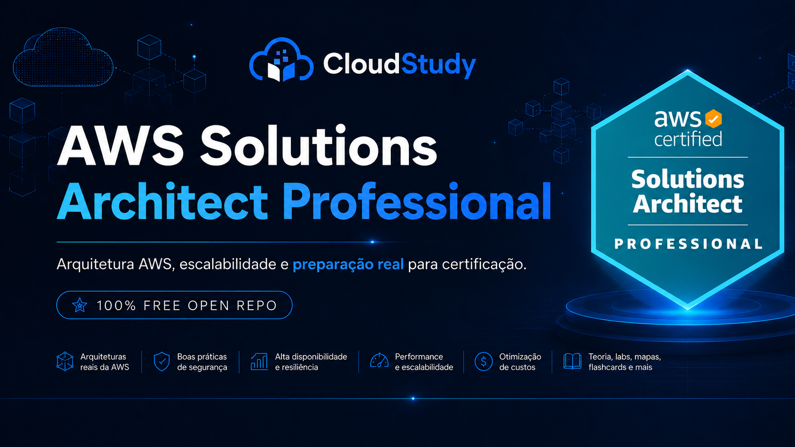
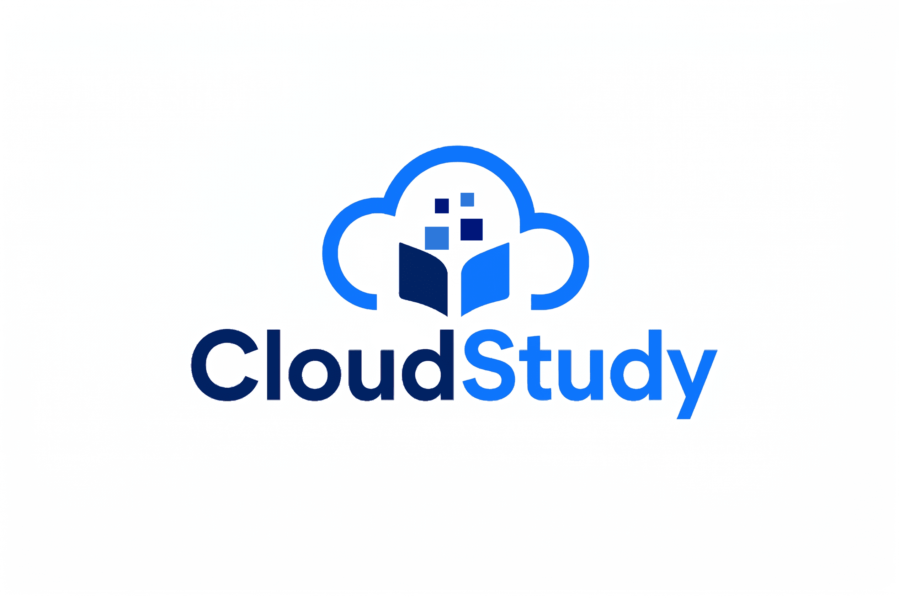

  

  

  <strong>English guide to AWS Certified Solutions Architect – Professional (SAP-C02), with exam domains, architectures, labs, flashcards, cheatsheets and questions.</strong>

  <strong>Join the CloudStudy waitlist for early access to the platform.</strong>

  

  
  &nbsp;&nbsp;
  

## Educational sponsorship

  This project is supported by <a href="https://cloudstudy.com.br">CloudStudy</a>.

 

<h1 align="center">AWS Certified Solutions Architect – Professional (SAP-C02)</h1>

  
  
  

  
  
  
  
  

  <a href="#how-to-use-this-repository">How to use</a> |
  <a href="#recommended-study-workflow">Study workflow</a> |
  <a href="#study-map">Study map</a> |
  <a href="#modules">Modules</a> |
  <a href="./30-Practice-Exams-and-Questions/README.md">Practice exams</a> |
  <a href="#additional-aws-learning-paths">AWS learning paths</a>

Open learning materials by Thiago Cardoso | <a href="https://www.linkedin.com/in/analyticsthiagocardoso">LinkedIn</a>

---

> **Exam version note — November 16, 2026:** AWS lists November 16 as the last day for SAP-C02 and November 17 as the start of SAP-C03 delivery. This edition intentionally preserves the SAP-C02 curriculum and four-domain structure. See the [official certification update](https://aws.amazon.com/blogs/training-and-certification/september-2026-new-offerings/).

## What you will find in this repository

| Topic | Materials included |
|---|---|
| Organizational architecture | Multi-account architecture, Organizations, Control Tower, governance and cross-account access. |
| Advanced and hybrid networking | Transit Gateway, Direct Connect, VPN, hybrid DNS, PrivateLink and segmentation. |
| New solutions | Compute, storage, databases, integration, serverless and containers. |
| Continuous improvement | Observability, security, performance, reliability, quotas and automation. |
| Disaster recovery | RTO/RPO, backup, replication, testing and business continuity. |
| Migration and modernization | The 7 Rs, assessment, MGN, DMS, SCT, DataSync, Snow Family and gradual modernization. |
| Cost optimization | FinOps, tagging, Cost Explorer, Budgets, Savings Plans and rightsizing. |
| Review and practice exams | SAP-C02-style questions, domain practice exams and an error log. |

## Where to start

- **Already comfortable with AWS architecture fundamentals:** start with [Module 01](./01-Introduction-SAP-C02/README.md) and follow the sequence through the official resources.
- **Need to strengthen architectural fundamentals:** review the [Solutions Architect Associate](https://github.com/Thiago-code-lab/aws-certified-solutions-architect-associate-brasil/tree/saa-c03-english) path before the more advanced modules.
- **Final review:** use [Practice Exams and Questions](./30-Practice-Exams-and-Questions/README.md), [domain practice exams](./30-Practice-Exams-and-Questions/domain-practice-exams.md), the [error log](./30-Practice-Exams-and-Questions/error-log.md) and the [SAP-C02 final review](./30-Practice-Exams-and-Questions/final-review-sap-c02.md).

> An open English learning path for structured preparation for AWS Certified Solutions Architect – Professional (SAP-C02).

Official repository: https://github.com/Thiago-code-lab/aws-certified-solutions-architect-professional-brasil

## About this repository

This repository organizes SAP-C02 preparation around the main topics covered by the Professional certification. It develops architectural reasoning for scenarios involving multiple accounts, hybrid environments, regulatory requirements, migration, modernization, continuity, security and cost.

The Portuguese source was condensed for a focused public learning experience: modules retain their essentials through overviews, architectural decisions, exam cues, pitfalls, questions, flashcards, cheatsheets, use cases and official links. This English edition preserves that source coverage and its varied depth.

## Exam structure and domains

| Domain | Weight | Practical coverage | Main modules |
|---|---:|---|---|
| Design Solutions for Organizational Complexity | 26% | Multi-account architecture, governance, hybrid networking, centralized security and organizational resilience | 02, 03, 04, 05, 06, 07 |
| Design for New Solutions | 29% | Deployment, continuity, security, reliability, performance, data, integration, serverless and containers | 08, 09, 10, 11, 12, 13, 14, 15, 16, 17 |
| Continuous Improvement for Existing Solutions | 25% | Observability, security, performance, reliability, quotas, automation and cost | 18, 19, 20, 21, 22, 27 |
| Accelerate Workload Migration and Modernization | 20% | Assessment, the 7 Rs, workload and data migration, modernization and gradual refactoring | 23, 24, 25, 26, 28, 29 |

## Study map

| Week | Focus | Modules |
|---|---|---|
| 1 | Professional mindset, multi-account architecture, identity and governance | 01 to 04 |
| 2 | Advanced networking, hybrid connectivity and network security | 05 to 07 |
| 3 | Compute, high availability and global traffic | 08 to 10 |
| 4 | Storage and databases | 11 to 13 |
| 5 | Integration, serverless and containers | 14 to 16 |
| 6 | Deployment, observability and auditing | 17 to 18 |
| 7 | Security, DR, performance and quotas | 19 to 21 |
| 8 | FinOps, discovery and migration strategy | 22 to 23 |
| 9 | Workload migration, data transfer and modernization | 24 to 27 |
| 10 | Real-world scenarios, labs, practice exams and resources | 28 to 31 |

## Modules

| # | Module | Predominant domain | Link |
|---|---|---|---|
| 01 | Introduction to SAP-C02 | Foundations / Strategy | [README](./01-Introduction-SAP-C02/README.md) |
| 02 | AWS Organizations, Control Tower and Multi-Account Architecture | Organizational Complexity | [README](./02-AWS-Organizations-Control-Tower-and-Multi-Account-Architecture/README.md) |
| 03 | IAM Identity Center, Federation and Cross-Account Access | Organizational Complexity | [README](./03-IAM-Identity-Center-Federation-and-Cross-Account-Access/README.md) |
| 04 | Governance, SCPs, RAM and Service Catalog | Organizational Complexity | [README](./04-Governance-SCPs-RAM-and-Service-Catalog/README.md) |
| 05 | Advanced Networking, VPC and Transit Gateway | Organizational Complexity | [README](./05-Advanced-Networking-VPC-and-Transit-Gateway/README.md) |
| 06 | Hybrid Connectivity, Direct Connect, VPN and DNS | Organizational Complexity | [README](./06-Hybrid-Connectivity-Direct-Connect-VPN-and-DNS/README.md) |
| 07 | PrivateLink, Network Firewall, WAF and Shield | Organizational Complexity / Security | [README](./07-PrivateLink-Network-Firewall-WAF-and-Shield/README.md) |
| 08 | EC2, Auto Scaling and Compute Strategies | Design for New Solutions | [README](./08-EC2-Auto-Scaling-and-Compute-Strategies/README.md) |
| 09 | High Availability, Multi-AZ and Multi-Region | Design for New Solutions | [README](./09-High-Availability-Multi-AZ-and-Multi-Region/README.md) |
| 10 | Route 53, CloudFront and Global Accelerator | Design for New Solutions | [README](./10-Route53-CloudFront-and-Global-Accelerator/README.md) |
| 11 | S3, EBS, EFS, FSx and Storage Strategies | Design for New Solutions | [README](./11-S3-EBS-EFS-FSx-and-Storage-Strategies/README.md) |
| 12 | RDS, Aurora and Relational Database Strategies | Design for New Solutions | [README](./12-RDS-Aurora-and-Relational-Database-Strategies/README.md) |
| 13 | DynamoDB, ElastiCache and Purpose-Built Databases | Design for New Solutions | [README](./13-DynamoDB-ElastiCache-and-Purpose-Built-Databases/README.md) |
| 14 | SQS, SNS, EventBridge and Step Functions | Design for New Solutions | [README](./14-SQS-SNS-EventBridge-and-Step-Functions/README.md) |
| 15 | Lambda, API Gateway and Serverless Architectures | Design for New Solutions | [README](./15-Lambda-API-Gateway-and-Serverless-Architectures/README.md) |
| 16 | ECS, EKS, Fargate and Containers | Design for New Solutions | [README](./16-ECS-EKS-Fargate-and-Containers/README.md) |
| 17 | CloudFormation, CI/CD and Deployment Strategies | Design for New Solutions | [README](./17-CloudFormation-CICD-and-Deployment-Strategies/README.md) |
| 18 | CloudWatch, CloudTrail, Config and Observability | Continuous Improvement | [README](./18-CloudWatch-CloudTrail-Config-and-Observability/README.md) |
| 19 | Security, KMS, Secrets Manager, GuardDuty and Security Hub | Continuous Improvement / Security | [README](./19-Security-KMS-Secrets-Manager-GuardDuty-and-Security-Hub/README.md) |
| 20 | Disaster Recovery, Backup, RTO and RPO | Continuous Improvement | [README](./20-Disaster-Recovery-Backup-RTO-and-RPO/README.md) |
| 21 | Performance, Reliability and Service Quotas | Continuous Improvement | [README](./21-Performance-Reliability-and-Service-Quotas/README.md) |
| 22 | Cost Optimization and FinOps | Continuous Improvement | [README](./22-Cost-Optimization-and-FinOps/README.md) |
| 23 | Migration Hub, Discovery and the 7 Rs | Migration and Modernization | [README](./23-Migration-Hub-Discovery-and-the-7-Rs/README.md) |
| 24 | AWS MGN, DMS, SCT and Workload Migration | Migration and Modernization | [README](./24-AWS-MGN-DMS-SCT-and-Workload-Migration/README.md) |
| 25 | DataSync, Snow Family, Transfer Family and Data Transfer | Migration and Modernization | [README](./25-DataSync-Snow-Family-Transfer-Family-and-Data-Transfer/README.md) |
| 26 | Modernization, Serverless, Containers and Decoupling | Migration and Modernization | [README](./26-Modernization-Serverless-Containers-and-Decoupling/README.md) |
| 27 | Well-Architected Framework and Advanced Trade-Offs | All domains | [README](./27-Well-Architected-and-Advanced-Trade-Offs/README.md) |
| 28 | Real-World Architecture Use Cases | All domains | [README](./28-Real-World-Architecture-Use-Cases/README.md) |
| 29 | Hands-On Labs | Practice | [README](./29-Hands-On-Labs/README.md) |
| 30 | Practice Exams and Questions | Final review | [README](./30-Practice-Exams-and-Questions/README.md) |
| 31 | Glossary and Resources | Resources | [README](./31-Glossary-and-Resources/README.md) |

## Source module maturity

The table below preserves the source's editorial maturity classifications. The Portuguese README labels the listed modules as developed, with scenarios, decisions, trade-offs, questions, flashcards, cheatsheets, use cases, official links and workshops where applicable. Inspection shows that many of these files still use shared introductory templates. Treat these labels as historical source metadata, not a guarantee of comprehensive Professional-level coverage. The detailed hybrid-connectivity questions, FinOps cases and modernization materials retain their additional depth in this edition.

| Module | Source classification | Topic |
|---|---|---|
| 02 | Developed in source metadata | Organizations, Control Tower and multi-account architecture |
| 03 | Developed in source metadata | IAM, Identity Center, federation and cross-account access |
| 05 | Developed in source metadata | Advanced networking, TGW and PrivateLink |
| 06 | Developed in source metadata | Hybrid connectivity, DX, VPN and DNS |
| 12 | Developed in source metadata | RDS, Aurora and relational strategies |
| 17 | Developed in source metadata | CloudFormation, CI/CD and deployment |
| 19 | Developed in source metadata | KMS, Secrets Manager, GuardDuty and Security Hub |
| 20 | Developed in source metadata | DR, backup, RTO and RPO |
| 22 | Developed in source metadata | FinOps and cost optimization |
| 23 | Developed in source metadata | Migration Hub, discovery and the 7 Rs |
| 26 | Developed in source metadata | Modernization, serverless, containers and decoupling |
| Other modules | Structure or initial curation | These are not yet comprehensive, in-depth lessons |

## How to use this repository

1. Start with module 01 to calibrate Professional-level expectations and long-scenario reading.
2. Study the modules in order: governance, identity and networking underpin many later decisions.
3. Use cheatsheets and use cases to review decision criteria before answering questions.
4. Record recurring errors in the module 30 error log.
5. Prioritize official AWS documentation when uncertain about current behavior, quotas or recommendations.

## Recommended study workflow

1. Read the module README to understand context, decisions and trade-offs.
2. Review cheatsheet.md before answering questions.
3. Study use-cases.md and identify each scenario's dominant requirement.
4. Answer questions.md before revealing its answers.
5. Address gaps with flashcards, official links and domain practice exams.

## Additional AWS learning paths

| Learning path | When to use it |
|---|---|
| [AWS Solutions Architect Associate](https://github.com/Thiago-code-lab/aws-certified-solutions-architect-associate-brasil/tree/saa-c03-english) | Review architectural fundamentals before Professional topics. |
| [AWS Cloud Practitioner](https://github.com/Thiago-code-lab/aws-certified-cloud-practitioner-brasil/tree/clf-c02-english) | Strengthen basic cloud concepts, AWS services and terminology. |
| [AWS AI Practitioner](https://github.com/Thiago-code-lab/aws-certified-ai-practitioner-brasil/tree/aif-c01-english) | Explore AI on AWS as an additional learning path. |

## Follow CloudStudy

Continue preparing with [CloudStudy](https://cloudstudy.com.br), follow updates on [Instagram](https://www.instagram.com/cloudstudy.ai/) and follow the [LinkedIn page](https://www.linkedin.com/company/cloudstudy-ai/).

For practical data content and AWS projects, also see [Data Engineering on AWS](https://www.udemy.com/course/engenharia-de-dados-na-aws-do-zero-aos-projetos-reais/?referralCode=E28670B9116BA68E08A9).

## GitHub study navigation

- [Exam domain learning paths](./EXAM_DOMAIN_PATHS.md).
- [Real-world architecture scenarios](./28-Real-World-Architecture-Use-Cases/README.md).
- [Hands-on lab and workshop index](./29-Hands-On-Labs/README.md).
- Every module links its flashcards, cheatsheet, use cases, questions and official resources under Navigation or Module files.
- [Official SAP-C02 exam guide](https://docs.aws.amazon.com/aws-certification/latest/solutions-architect-professional-02/solutions-architect-professional-02.html).
- [English edition coverage, technical corrections and validation audit](./docs/english-edition/README.md).

## Contributing and license

See [CONTRIBUTING.md](./CONTRIBUTING.md), [SECURITY.md](./SECURITY.md) and [CHANGELOG.md](./CHANGELOG.md). Contributions to this edition should target `sap-c02-english`.

This open-source repository is available under the [MIT license](./LICENSE). CloudStudy community and promotional destinations may be in Portuguese; original banner artwork is preserved.
